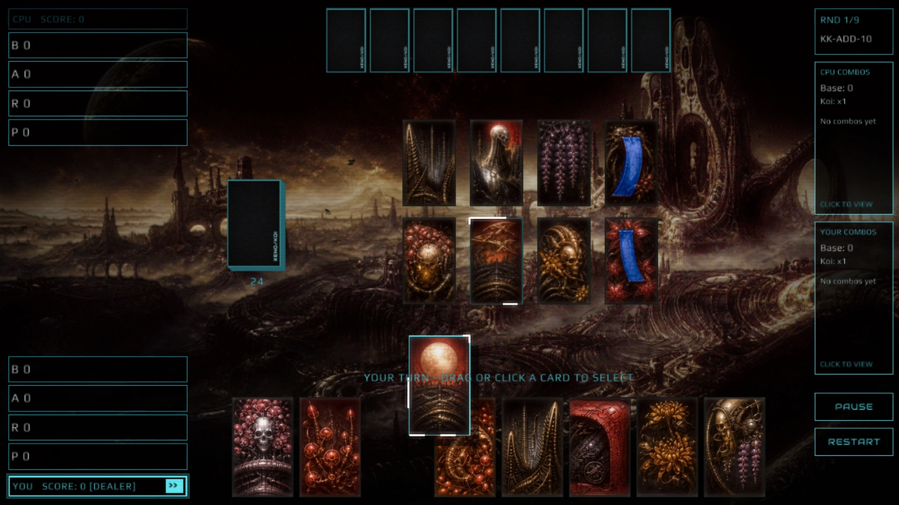
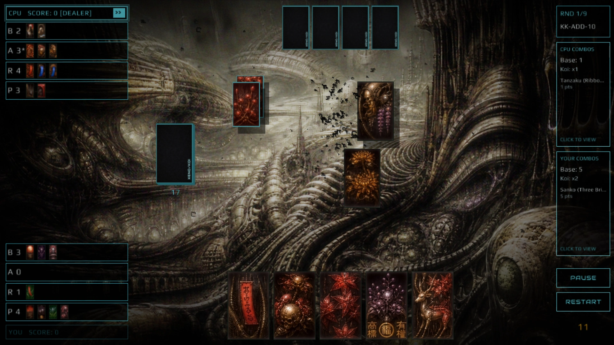

<a href="https://aquaslopper.github.io/Xeno-koi/play/"></a>&nbsp;
<a href="https://aquaslopper.github.io/Xeno-koi/how-to-play/"></a>&nbsp;
<a href="https://github.com/Aquaslopper/Xeno-koi/releases/latest"></a>

**The browser build is the whole game** — the same C, compiled to WebAssembly. No install, no account, no asset download.

---

## The game in four lines

* **48 cards, twelve months of four.** You capture by **month**, never by picture: any January card matches any January card on the table.
* **Build a set, then choose.** A captured set is a **yaku**. Bank it (**Shobu**) and take the points, or call **Koi-Koi** and keep playing for a bigger award.
* **Pushing cuts both ways.** Every Koi-Koi you call raises your own multiplier; if the opponent calls it and then beats you, their call doubles what *they* take.
* **Five rule sets, twelve opponents, then [DEUS SUPREMUS](https://aquaslopper.github.io/Xeno-koi/reference/deus-supremus/).** He is not an opponent so much as a wall, and he has his own page.

Everything above is explained with real card pictures in the rulebook: **[How to Play](https://aquaslopper.github.io/Xeno-koi/how-to-play/)**.

## Screenshots





## Where to read what

| You want to | Page |
|---|---|
| Learn the game in one sitting, with card pictures | [How to Play](https://aquaslopper.github.io/Xeno-koi/how-to-play/) |
| Pick a rule set before a match | [Rulesets](https://aquaslopper.github.io/Xeno-koi/rulesets/) |
| Know what a combination is worth | [Yaku & Scoring](https://aquaslopper.github.io/Xeno-koi/scoring/yaku/) |
| Know why a score multiplied the way it did | [Multipliers & Awards](https://aquaslopper.github.io/Xeno-koi/scoring/multipliers/) |
| Look up one of the 48 cards | [Cards](https://aquaslopper.github.io/Xeno-koi/reference/cards/) |
| Set a campaign difficulty and stage | [Modes & Settings](https://aquaslopper.github.io/Xeno-koi/reference/modes/#campaign-setup) |
| Know what the CPU is thinking, per difficulty | [Difficulty](https://aquaslopper.github.io/Xeno-koi/reference/difficulty/) |
| Study his atlas, tile by tile | [DEUS SUPREMUS](https://aquaslopper.github.io/Xeno-koi/reference/deus-supremus/) |
| Check current campaign and browser notes | [Game notes](https://aquaslopper.github.io/Xeno-koi/errata/) |

## Overview

**Xeno Koi** is a digital adaptation of the traditional Japanese card game Koi-Koi, wrapped in a dark, HR Giger-inspired biomechanical aesthetic and a 1979 CRT terminal UI.

Designed for both casual play and hardcore competitive strategy, the engine features multiple rule variations, smooth physics-based card interactions, and an atmospheric audiovisual presentation.

## Core Gameplay Features

* **Oya-gime (Dealer Selection):** Interactive pre-match phase where players draw a card to determine the starting dealer based on month order.
* **Cinematic Game Feel:** Heavy pasteboard card physics featuring Y-axis hopping, dynamic drop shadows, and 150ms "Hitlag" (freeze-frame) on card captures to emphasize physical weight.
* **Continuous Audio Flow:** Safe-loading audio engine with crossfaded state transitions and continuous match-music shuffling.
* **Persistent Statistics:** Tracks win rates, total matches, highest round scores, and the player's most frequent/favorite Yaku (combo), displayed via an arcade-style scrolling marquee on the main menu.
* **Koi-Koi Streak Multiplier:** Pushing your luck now pays both ways. Every Koi-Koi call in a round raises the **caller's own** multiplier by +1 (`x1` -> `x2` -> `x3` ... capped at `x6`), stacking on top of the `x2` 7+ Points multiplier and the `x2` Opponent Koi-Koi multiplier. A player who calls Koi-Koi three times and then banks a 6-point hand scores `6 x 4 = 24`.

## Supported Rulesets

The game supports 5 distinct rule variations, selectable in the Options menu to cater to different playstyles:

| Rule set | What it changes |
|---|---|
| **[Nintendo](https://aquaslopper.github.io/Xeno-koi/rulesets/nintendo/)** | The classic, balanced Koi-Koi rule set. One Koi-Koi call per player per round. |
| **[FudaWiki](https://aquaslopper.github.io/Xeno-koi/rulesets/fudawiki/)** | Modern standard rules with slightly adjusted combo values: bigger Goko and Sanko, unlimited Koi-Koi calls. |
| **[KK-ADD-10](https://aquaslopper.github.io/Xeno-koi/rulesets/kk-add-10/)** | A high-scoring variant where fixed sets and counted cards stack additively, and the Sake Cup counts as a plain. Includes the 1000 ms speed minigame and match-end minipoint conversion. A good place for beginners to start. |
| **[Tournament](https://aquaslopper.github.io/Xeno-koi/rulesets/tournament/)** | Disables "Hanami-zake" (Curtain + Cup) and "Tsukimi-zake" (Moon + Cup) Viewings. The Sake Cup is treated strictly as an animal card, eliminating cheap luck-based wins and forcing strategic combo building. |
| **[Yakuza](https://aquaslopper.github.io/Xeno-koi/rulesets/yakuza/)** | Tournament scoring plus "Dealer's Privilege" (Oya-ken). If a round ends in exhaustion with a 0-0 draw, the current Dealer automatically wins the round and is awarded 6 points. |

## Technical Architecture

* **Language:** C99
* **Framework:** Raylib 5.5
* **Graphics:**
  * **GLSL Depth-Fog Shader:** A custom fragment shader that calculates background luminance to map procedural, drifting sine-wave fog exclusively to the dark, distant valleys of the 2D background art.
  * **Native Particle Engine:** Fixed-size memory pools handling ambient phosphor ash and high-velocity capture bursts.

### The table, to scale


This is not a screenshot and not a sketch. It is the geometry in `src/` painted at 1:1 — the file is 1280 x 720 because that is the canvas the engine lays the table out on before any window scaling — and `tools/make_board_figure.py` generates it from the same constants the painter uses, so it cannot quietly drift from the game. The numbers are `board_draw()`'s own paint-order numbers, taken from its comments.

| # | On the table | Where it is measured from |
|---:|---|---|
| **2** | Left column: the two score boxes, and under each side's four capture lanes sorted by card type -- Brights, Animals, Ribbons, Plains | `src/ui_board.c:300-302`, `draw_capture_lanes()` |
| **3** | His hand, face-down: 56 x 91 backs, 62 px apart, centred on x = 710 at y = 12 | `src/ui_board.c:305-308` |
| **4** | The stock: one 76 x 124 rectangle at (330, 262), stacked `stock_count >> 2` times so a full stock draws 7 deep, with the count under it | `src/ui_board.c:158`, `:320-323` |
| **5** | The field: two rows at y = 170 and y = 310, 96 px apart, centred inside the 650 x 400 box that starts at x = 430, the spacing shrinking when a row would not fit | `src/board_layout.c:16-27` |
| **7** | Your hand: 88 x 143 cards, 96 px apart, centred on the same axis, lifted to y = 552 while you hover one | `src/ui_board.c:169-172` |
| **10** | The status line, centred on x = 710 at y = 529; the Master timer sits above it | `src/ui_board_status.c:73-80` |
| **11** | Right column: round and rule set, then both players' clickable combo panels (paused details), then PAUSE / RESTART | `src/ui_combos.c`, `src/ui_board.c` |

Three things worth noticing. Everything in play is centred on **x = 710**, not the canvas centre at 640, and the left column stops at 267 while the right starts at 1160. A field card is painted **smaller** than a hand card (76 x 124 against 88 x 143) and grows or shrinks mid-flight instead of popping. And four regions are missing from the map because they have no rectangle to hold: **1** is the background, and **6**, **8** and **9** -- the stock card just revealed, the card under your cursor, and cards in flight -- only exist for a moment.

The state shown is the opening of a round, which is the only state where every count is fixed by the rules: 8 to you, 8 to him, 8 on the field, 24 in the stock, no captures yet. The cards are the real art, cropped from `assets/atlas.png`. Two January cards sit on that field on purpose -- a pair is legal, while all four of a month or exactly four pairs is a misdeal the engine redeals (`has_four_of_month_or_four_pairs()`, `src/engine.c:36-44`) -- and the opening is the same one `docs/tutorial.md` is played out on, so the picture and the walkthrough are one table.

## Install and run

1. Download the latest `.zip` from the **[Releases](https://github.com/Aquaslopper/Xeno-koi/releases/latest)** tab.
2. Extract the folder to your computer. *(Ensure the `assets/` folder remains in the same directory as the executable).*
3. **Optional Custom Audio:** On desktop, open **Options → page 2 → Music Folder**, paste the full path to a folder of MP3s, and click **Apply**. Up to 10 playable tracks are used without renaming them; **Use Default** restores the built-in match music. Menu music and sound effects stay unchanged. You can still replace audio in `assets/music/` and `assets/sfx/` using the shipped filenames. See [custom music details](docs/reference/modes.md#custom-music-desktop).
4. Run `KoiKoi.exe`.

## Documentation

The wiki is the reference for the rules, and it is part of the repo: it lives in [`docs/`](docs/) and is published at
**[aquaslopper.github.io/Xeno-koi](https://aquaslopper.github.io/Xeno-koi/)**.
Its scoring tables and its card images are **generated from the C source** by `tools/gen_wiki_tables.py` and
`tools/make_card_images.py`, so a rule change and its documentation cannot drift apart. When you change scoring or
cards, run `python3 tools/gen_wiki_tables.py` and commit the result; CI checks it.

The masthead band and the buttons at the top of this file are generated the same way, from the shipped art, by
`tools/make_readme_art.py`.

## License

XENO/KOI is released under the **MIT License** — see [`LICENSE`](LICENSE). Play it, fork it,
change it, ship your own version; keep the copyright notice with it. The music is Aquaslopper's
own work, and the bundled fonts and raylib keep their own licences — both are noted in
[`Credits.md`](Credits.md).

## Building from Source

For developers wishing to compile the game from source:
```bash
# Clone the repository
git clone https://github.com/Aquaslopper/Xeno-koi.git
cd xeno-koi

# Compile using MinGW (Windows)
x86_64-w64-mingw32-gcc -std=c99 -O2 src/*.c -I/path/to/raylib/src -lraylib -lopengl32 -lgdi32 -lwinmm -o XenoKoi.exe
```
