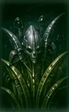
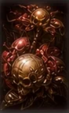
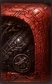
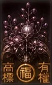

# How to Play

Koi-Koi is a trick-taking card game played with a 48-card Hanafuda deck. You are trying to **capture** cards that form scoring combinations (called **yaku**). The first to a higher total across the chosen number of rounds wins the match.

## Match structure

- A **match** is a fixed number of **rounds**, chosen in Options (1 to 12).
- Each round produces an award for one player, or a draw.
- The player with the higher total score after the last round wins the match. Equal totals are a draw.
- A **misdeal** is not counted as a round.

## The cards

The deck has 48 cards in 12 months of 4 cards each. Cards come in four types. Here is every card of each type, so you can learn them by sight:

| Type | Count | Notes | Cards |
|---|---:|---|---|
| Brights | 5 | The most valuable cards. Used for the Bright yaku. | { .card-thumb } { .card-thumb } { .card-thumb } { .card-thumb } { .card-thumb } |
| Animals | 9 | Includes the Sake Cup (09-A). | { .card-thumb } { .card-thumb } { .card-thumb } { .card-thumb } { .card-thumb } { .card-thumb } { .card-thumb } { .card-thumb } { .card-thumb } |
| Ribbons | 10 | Some are Poetry (red) or Blue ribbons, which form special sets. | { .card-thumb } { .card-thumb } { .card-thumb } { .card-thumb } { .card-thumb } { .card-thumb } { .card-thumb } { .card-thumb } { .card-thumb } { .card-thumb } |
| Plains | 24 | Mostly worth points only in bulk (Kasu). | { .card-thumb } { .card-thumb } { .card-thumb } { .card-thumb } { .card-thumb } { .card-thumb } { .card-thumb } { .card-thumb } { .card-thumb } { .card-thumb } { .card-thumb } { .card-thumb } { .card-thumb } { .card-thumb } { .card-thumb } { .card-thumb } { .card-thumb } { .card-thumb } { .card-thumb } { .card-thumb } { .card-thumb } { .card-thumb } { .card-thumb } { .card-thumb } |

The **Sake Cup** (09-A) is an Animal, and it forms the Hanami-zake and Tsukimi-zake sets with the Curtain and the Moon (not in Tournament or Yakuza). The **Rain Man** (11-B) is a Bright, but it is not a wild card. See [Cards](reference/cards.md) for the special cards.

Here is one full month — January (Pine). All four share the same month, so any of them matches any other January card on the field:

{ .card-thumb } { .card-thumb } { .card-thumb } { .card-thumb }

*January: Crane (Bright), Poetry ribbon, and two Plains.*

Face-down cards (your opponent's hand and the stock) show the card back:

{ .card-thumb }

**Matching is by month only.** A card matches any field card of the same month. Card art, type, and name never decide a match. The Rain Man, Sake Cup, and Lightning cards are not wild.

### Matching examples

**Same month: capture.** You play the January Crane onto a field that holds a January Plain. The months match, so both cards go to your pile:

{ .card-thumb } **played** &nbsp; + &nbsp; { .card-thumb } **on the field** &nbsp; **→ capture both**

**Different month: no capture.** You play the same January Crane onto a field that holds a February Warbler. The months differ, so nothing is captured and the Crane stays on the field:

{ .card-thumb } **played** &nbsp; + &nbsp; { .card-thumb } **on the field** &nbsp; **→ no capture**

Full card list: [Cards](reference/cards.md).

## Setting up a match

### Oya-gime: who deals first

Before the first round, each side picks from two face-down cards. The card with the **earlier month** wins the deal. If the months are the same, the higher card type wins (Bright over Animal over Ribbon over Plain). The winner is the **dealer** and plays first.

After the first round, the **winner of the previous round deals**. If the round was a draw, the dealer stays the same.

### Dealing

- 8 cards to you, 8 to the CPU.
- 8 cards face-up on the **field** (the table).
- 24 cards face-down in the **stock** (the draw pile).

### Misdeals

If the field starts with all four cards of one month, or with exactly four pairs, the deal is void. The round is redealt with the same dealer, and the redeal is not counted.

### Lucky hands

After a valid deal, the game checks each hand for a lucky opening:

- **Teshi:** all four cards of one month in your 8-card hand.
- **Kuttsuki:** four pairs in your hand (two of each month, four months).

| Lucky hand | Your 8-card hand looks like | Result |
|---|---|---|
| **Teshi** (four of one month) | Four January cards: { .card-thumb } { .card-thumb } { .card-thumb } { .card-thumb } plus any four other cards | 6 points |
| **Kuttsuki** (four pairs) | Two cards of each of four months: Jan { .card-thumb } { .card-thumb } · Feb { .card-thumb } { .card-thumb } · Mar { .card-thumb } { .card-thumb } · Apr { .card-thumb } { .card-thumb } | 6 points |

A lucky hand wins the round immediately for **6 points**, with no multipliers, and that player becomes the next dealer. If **both** players are lucky, the round is a 0–0 draw (except in Yakuza, see [Yakuza](rulesets/yakuza.md)).

Both are checked only once, on the 8 cards dealt at the start of the round.

## Taking a turn

Each turn has two stages, and you always do both: a **hand stage**, then a **stock stage**.

| Stage | Where the card comes from | Who picks it |
|---|---|---|
| **1. Hand** | Your 8-card hand | You, face-up, on the table |
| **2. Stock** | The top of the face-down stock | Nobody. It is turned over at random |

**A worked turn, in two steps** (the field starts with a January Plain and no February card):

1. **Hand stage.** You play the January Crane from your hand. The field holds a January Plain, so you capture both: { .card-thumb } + { .card-thumb } go to your pile.
2. **Stock stage.** The top stock card is turned over: { .card-thumb } **→** { .card-thumb }. The field has no February card, so the Warbler stays on the field.

### Stage 1: play a card from your hand

Pick a card from your hand and play it onto the field:

| Field matches for that card's month | What happens |
|---:|---|
| 0 | The card is placed on the field. Nothing is captured. |
| 1 | You capture the played card and the matching field card. |
| 2 | You choose which one of the two matching field cards to capture. |
| 3 | You capture the played card and all three matching field cards. |

If a card has a match, it **must** capture. You cannot put it down on the field while a match is available. You may play a non-matching card even when another of your cards would match.

### Stage 2: draw from the stock

Reveal the top card of the stock and apply the same rules against the **updated** field. This includes the card you just played, if it landed on the field. The stock card never enters your hand.

If the stock card has **two** matches, you must choose one. You cannot cancel.

### Scoring the turn, and calling Koi-Koi or Shobu

After both stages, the game scores the cards you have captured this round.

- If your score has **gone up** since your last call this round, you are asked to choose:
    - In **KK-ADD-10**, the question opens when a combo is **new or has grown in points** instead — see [KK-ADD-10](rulesets/kk-add-10.md#when-the-koi-koi-screen-opens).
  - **Shobu** (stop): the round ends and you score the award.
  - **Koi-Koi** (continue): play carries on, and you aim to score more. Your Koi-Koi call is recorded for the round.
- If your score has **not** gone up, there is no prompt and play passes to the other player.
- If you have **no cards left in hand**, Koi-Koi is not offered and the round ends automatically with your Shobu.
- Some rule sets **force** a Shobu after your first Koi-Koi call. See each rule set page.

**Example: calling Shobu or Koi-Koi.** You capture the January Crane, the March Curtain and the August Moon. None of them is the Rain Man, so together they form **Sanko** (Three Brights). Under KK-ADD-10, Sanko is worth 5 points (see the [Yaku table](scoring/yaku.md)). Your score went up from zero, so the Koi-Koi screen opens:

{ .card-thumb } { .card-thumb } { .card-thumb } **→ Sanko, 5 points →** choose **Shobu** to end the round and score 5, or **Koi-Koi** to play on and try for more.

Calling Koi-Koi is a bet. Each of your Koi-Koi calls raises your own multiplier, and the opponent calling Koi-Koi doubles your award if you win. See [Multipliers](scoring/multipliers.md).

## Ending a round

The round ends in one of these ways:

1. **Shobu.** A player stops and scores the award.
2. **A lucky hand** (see above).
3. **Exhaustion.** Both hands are empty and nobody called Shobu. This is a **0–0 draw** and the dealer stays the same. In a 16-turn round, 8 stock cards are never drawn.

After a round, the results screen shows each yaku, the base points, every multiplier, and the final award.

## Controls

- **Play a card:** click and drag a card from your hand onto the table.
- **Choose a target:** when a choice appears, click the card you want to capture. Some choices can be cancelled, and the stock choice cannot.
- **Pause:** `Esc` or `P`.
- **Easy difficulty:** hand cards that can capture glow, and while you drag a card, field cards of the same month glow to help you match. Hover over a face-up card for half a second to see its month/suit, type (including its Japanese name), and card name beside the cursor. This also works on captured cards and cards in choice overlays; face-down cards never reveal metadata. Tooltips disappear when you leave the card, drag, pause, or switch away from Easy difficulty.

## Winning

Each round's award goes to the round winner. Points accumulate across the match, and the highest total at the end wins. The match result screen records the round-by-round ledger.

## Next steps

- Choose a rule set: [Rulesets](rulesets/index.md)
- Learn what each combination scores: [Yaku & Scoring](scoring/yaku.md)
- Understand how multipliers stack: [Multipliers](scoring/multipliers.md)
- Play through the campaign: [Opponents](reference/opponents.md) and [Modes](reference/modes.md)
