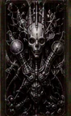

# DEUS SUPREMUS { .deus-title }

Sector 13 · a mode, not a difficulty setting · 15 seconds · his own atlas

He is the last thing in the campaign and the only one that is not a rung on the ladder: the Easy,
Hard and Master bands decide how often the CPU plays its best move, and he plays it every time.
Everything below is generated from the same sources as the [difficulty curve](difficulty.md), so
when he is re-tuned this page follows - `python3 tools/gen_wiki_tables.py` and it is on the page
again.

## The atlas

Every other opponent plays with the coloured deck. He plays with `assets/atlas_deus.png`: the same
48 cards in the same 12 x 4 grid, drawn in mono. This is the whole sheet, once, with his own grid
over it - not 48 thumbnails, because where a card lives is the part worth learning.

<!-- BEGIN GENERATED: deus-atlas-map -->

<a class="deus-map-btn deus-map-zoom" href="#deus-atlas-study">zoom the sheet</a><a class="deus-map-btn deus-map-close" href="#">close</a><i></i> 15 cards he counts before calling Koi-Koihover a cell for the card, click to blow it up

010203040506070809101112

slot 0slot 1slot 2slot 3

<!-- END GENERATED: deus-atlas-map -->

The sheet is `docs/assets/deus-atlas.webp`, the native 2112 x 1144 of `assets/atlas_deus.png`,
copied out by `tools/make_card_images.py` and packed **losslessly** - measured against the source,
the difference is exactly zero, because on this image the linework is the content and a player is
looking at it 1:1. Three things to read off it:

- **Columns are months, rows are slots.** A card's cell is column `id >> 2` and row `id & 3`, so
  `id = (month - 1) * 4 + row` - the mapping `board_draw_card()` uses in `src/ui_board.c`. Cell
  labels come from `CARDS[]` in `src/cards.c`, which is why hovering a cell tells you the card.
- **The framed cells are his fifteen.** `SPECIAL_CARDS[]` in `ai_call_koi_koi()` (`src/ai.c`) is
  the list he checks before raising. Not a hint, a fact about his code: if a card in that list
  would block your declared yaku, he banks instead of calling Koi-Koi.
- **Nothing else differs.** Same ids, same cells, same yakus. The mono art is a texture swap, not
  a different deck - so everything you know about the coloured atlas transfers exactly.

## Who he is

<!-- BEGIN GENERATED: deus-dossier -->

| | DEUS SUPREMUS |
|---|---|
| **Designation** | ENTITY 13 // DEUS SUPREMUS |
| **Classification** | Omnipresent Machine God // Sector Null |
| **Priority yaku** | Brights |
| **Signature target** | { .card-mini } 12-B Phoenix (id 44) |
| **Match taunt** | *PURE MATHEMATICAL PERFECTION.* |
| **On a Koi-Koi call** | *INEVITABILITY CONFIRMED. KOI-KOI!* |

> The apex consciousness. Born from the convergence of all twelve sectors, Deus Supremus operates with pure mathematical perfection. It does not hesitate, does not blunder, and will exploit every vulnerability under ruthless Yakuza rules.

*(generated from `g_opponents[12]` in `src/cards.c` - his text, not a paraphrase)*

<!-- END GENERATED: deus-dossier -->

"Does not hesitate, does not blunder" is not flavour text. `ai_get_accuracy()` returns `100` for
the DEUS SUPREMUS band before it ever looks at which opponent you are facing, and the roll that normally
sends the CPU into a deliberate casual blunder can never miss. Every number on the
[difficulty page](difficulty.md) is his ceiling, reached in every column at once.

## What changes when you play him

| | | Where it comes from |
|---|---|---|
| **His accuracy** | 100% in every band, against every opponent | `ai_get_accuracy()` returns for the DEUS SUPREMUS band before the Easy/Hard/Master formulas are consulted, `src/ai.c` |
| **How he values a card** | +100 if it blocks you, +100 again if a card he is capturing blocks you | `eval_card_value_fast()`, `src/ai.c` - the denial bonus is his alone |
| **What he discards** | will not shed a blocking card: `-150` against Master's `-100`, and he dislikes an unfinished month twice as much, `-8` against `-4` | `ai_choose_hand()`, `src/ai.c` |
| **When he raises** | he banks instead of calling Koi-Koi if any of the fifteen framed cards above would block you | `ai_call_koi_koi()`, `src/ai.c` |
| **Your clock** | 15 seconds, always. The Master timer option is ignored, not defaulted | `src/ui_main.c` |
| **Running it out** | the match ends. No random card for you, no points, no win, no stats, no record - a banner, then the start screen | `src/ui_main.c`, against `engine_timeout_autoplay()` for every other band |
| **Ruleset** | Yakuza, selector locked | [Yakuza rules](../rulesets/yakuza.md#deus-supremus) |
| **Deck art** | his own mono atlas | `board_draw_card()` swaps the texture, `src/ui_board.c` |
| **The result screen** | no campaign clearance request appears, win or lose | `screens_draw_match_result()`, `src/ui_screens.c` |

## The first time you meet him

You will lose the first one, probably to the clock. That is the design: he is a mode where the
pressure is on your decisions, not on his. What the mechanics above mean in practice:

1. **Stop waiting for a gift.** Against Easy and Hard you are paid for the CPU's deliberate
   blunders. There are none here, so plan the round as if every card he still holds is the worst
   one for you.
2. **Bank earlier than feels right.** A timeout does not cost you a turn, it costs the match, and
   15 seconds is a decision budget rather than a thinking budget. If you have points on the table
   and the answer is not obvious, take the points.
3. **Assume the fifteen are held, not dumped.** The `-150` on discarding a blocking card means the
   cards you need stay in his hand until he has no choice. If a card you want is the framed one on
   the sheet above, treat it as gone for a long time.
4. **Believe a Koi-Koi call.** He checks the fifteen first. If he raises anyway, he has already
   decided your combo cannot block him - calling back is a gamble on a hand he has priced.
5. **Play the ruleset you are locked into.** Yakuza means viewings and no second chances on the
   award table: see [Yakuza](../rulesets/yakuza.md) rather than re-learning it here.
6. **Losing to the clock teaches you nothing permanent.** A timeout match writes no record and no
   stat, so you can walk away from a bad one and take another run at him immediately.

## Is he even reachable?

Normally DEUS SUPREMUS unlocks after all twelve opponents are cleared, on the terms described in
[Campaign and unlocks](modes.md#campaign-and-unlocks). He is currently open to everyone on purpose
while the mode is being tested - see [Errata & Known Issues](../errata.md), which is the entry to
re-check before you assume anything on this page is final.
