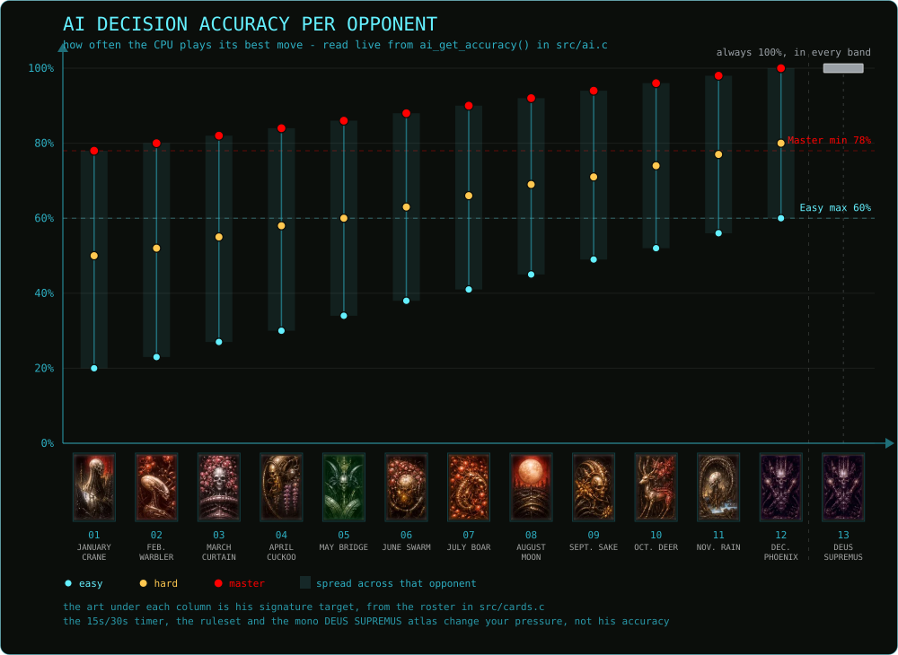

# Difficulty

Four settings decide how well the CPU plays. Everything here is about that one idea; the rest of the
match settings are on [Modes & Settings](modes.md).

| Difficulty | What it changes |
|---|---|
| **Easy** (default) | The CPU is weakest, and it calls Koi-Koi at random (50% of the time while it has 3 or more cards). Hand cards that can capture glow, and while you drag a card, field cards of the same month glow. |
| **Hard** | A stronger CPU. It needs at least 4 cards in hand before it will gamble on Koi-Koi, and it banks when you are already on the board. No glow hints. |
| **Master** | A strong CPU. It needs at least 3 cards in hand before gambling, and it banks instead of continuing when a card would complete one of your special combinations. A **turn timer** applies: 15 or 30 seconds, set in Options. If it runs out, a random card is played for you. |
| **[DEUS SUPREMUS](deus-supremus.md)** | The 100% accuracy setting, against Entity 13. It uses the Master decision logic with stronger card evaluation, always plays under Yakuza rules, locks the ruleset selector, and has a fixed 15-second turn timer. |

The CPU's Koi-Koi decision compares the **banked award now** with the **projected award** if it continues. It continues only when the projected award clearly beats banking. Once its multiplier is capped at ×6, it has no more streak upside, so it banks.

## Difficulty curve

The one number the CPU carries per opponent is how often it plays its best move; below that it
blunders on purpose. That number climbs with the opponent and jumps with the difficulty, and the
jump is the bigger of the two - **Easy against opponent 12 is still weaker than Master against
opponent 01**. Which is why the chart is one column per opponent, not one rising curve.

[DEUS SUPREMUS](deus-supremus.md) is not the thirteenth rung but a mode of his own: 100% in every band, with
Yakuza rules, a fixed 15-second timer and the mono atlas. The timer and the ruleset stay off the axis, because the
timer is your clock and DEUS forces Yakuza scoring - neither moves his
accuracy. See [Errata & Known Issues](../errata.md) for what the rulesets do change.

<!-- BEGIN GENERATED: difficulty-curve -->

| # | Opponent | Signature target | Priority yaku | Easy | Hard | Master |
|---:|---|---|---|---:|---:|---:|
| 01 | **JANUARY CRANE** | { .card-mini } 01-B Crane | Brights | 20% | 50% | 78% |
| 02 | **FEB. WARBLER** | { .card-mini } 02-A Warbler | Ribbons | 23% | 52% | 80% |
| 03 | **MARCH CURTAIN** | { .card-mini } 03-B Curtain | Brights | 27% | 55% | 82% |
| 04 | **APRIL CUCKOO** | { .card-mini } 04-A Cuckoo | Plains/Kasu | 30% | 58% | 84% |
| 05 | **MAY BRIDGE** | { .card-mini } 05-A Bridge | Animals | 34% | 60% | 86% |
| 06 | **JUNE SWARM** | { .card-mini } 06-A Butterflies | Animals | 38% | 63% | 88% |
| 07 | **JULY BOAR** | { .card-mini } 07-A Boar | Ino-Shika-Cho | 41% | 66% | 90% |
| 08 | **AUGUST MOON** | { .card-mini } 08-B Moon | Brights | 45% | 69% | 92% |
| 09 | **SEPT. SAKE** | { .card-mini } 09-A Sake Cup | Animals | 49% | 71% | 94% |
| 10 | **OCT. DEER** | { .card-mini } 10-A Deer | Ino-Shika-Cho | 52% | 74% | 96% |
| 11 | **NOV. RAIN** | { .card-mini } 11-B Rainman | Ribbons | 56% | 77% | 98% |
| 12 | **DEC. PHOENIX** | { .card-mini } 12-B Phoenix | Brights | 60% | 80% | 100% |
| 13 | **ENTITY 13 // DEUS SUPREMUS ([dossier](deus-supremus.md))** | { .card-mini } 12-B Phoenix | Brights | - | - | **100%** always |
| | *Ramp, 01 to 12* | | | +40 | +30 | +22 |

*Easy, Hard and Master are not picked against [DEUS SUPREMUS](deus-supremus.md): he overrides the band and plays optimally on every turn.*
<!-- END GENERATED: difficulty-curve -->

## Where else difficulty shows up

- The Master turn timer is chosen in [Options](modes.md#options), and [Rounds](modes.md#rounds)
  decide how long a match runs.
- How many rounds a win must last to earn a clearance coin depends on the difficulty you
  played: [Campaign and unlocks](modes.md#campaign-and-unlocks).
- [DEUS SUPREMUS](deus-supremus.md) is normally gated until M-12 is open. His current state is
  on [Errata & Known Issues](../errata.md).
