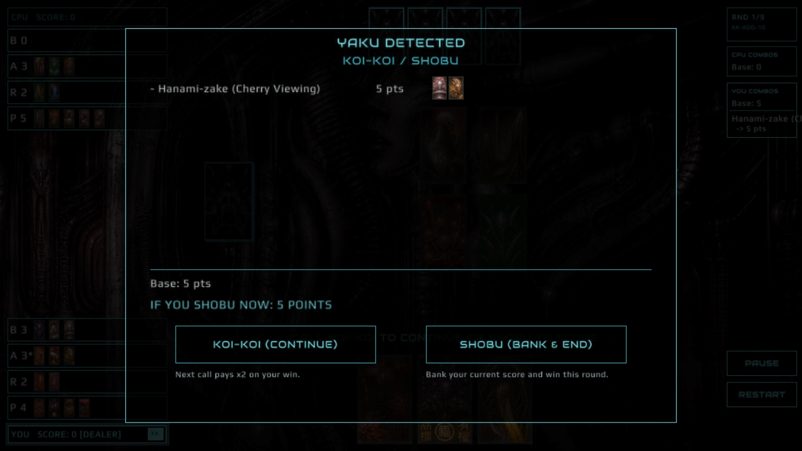

# KK-ADD-10

!!! note "The maintainer's house rule"
    KK-ADD-10 is the maintainer's own rule set, carried over from an earlier game. The maintainer considers it **a good first rule set for beginners**. The three counted families start scoring at clear thresholds (5 animals, 4 ribbons, 10 plains), and every card after that adds a point, so the score rises in visible steps.

    This rule set is **expected to change** as the maintainer tunes it. When it does, this page and the generated tables are updated together. If you are reading a rule from older material, check here first.

**Fixed sets and counted cards are added together**, rather than replacing each other. The Sake Cup also counts as a Plain. Expect bigger rounds and bigger swings.

## Summary

- **Fixed sets stack with counts.** Ino-shika-cho, Akatan, and Aotan are fixed at 5 each. Tane and Tanzaku are counted on top of them.
- **Akatan + Aotan as one combined set** scores 10. Tanzaku still stacks on top of it.
- **Tanzaku opens at 4 ribbons**, not 5. Each ribbon from the 4th onward adds 1.
- **Tane** scores from the 5th animal, and stacks with Ino-shika-cho.
- **Sake Cup counts as a Plain** for Kasu. It also still counts as an animal and for both Viewings.
- **Viewings are on.**
- **Unlimited Koi-Koi calls** per player per round, like FudaWiki.

## When the Koi-Koi screen opens

In KK-ADD-10 the screen is triggered **by the combos themselves**, not by the total score. It opens when:

- a **new combo** (yaku) appears in your captured cards, or
- a combo you already have **grows in points** — for example Sanko (5) becomes Shiko (8) and then Goko (10), or Tane, Tanzaku, or Kasu gains a point from an extra card.

Capturing a card that changes no combo opens no screen. The combos are compared with the ones you had at your last Koi-Koi decision, so each stage of a growing combo opens the screen again — and each stage is already worth its points when it opens.

<a class="figure-zoom-btn" href="#koi-screen-live">zoom the frame</a><a class="figure-zoom-btn" href="#">close</a>

*The screen at its own size, over the board it interrupted. Everything on it is `score_captures()` for the pile you have now (`src/ui_screens.c:463` onward), so the row count is the number of combos, not the number of cards - the reason this ruleset keeps asking.*

The Brights growing, stage by stage — each row opens the screen:

{ .card-thumb } { .card-thumb } { .card-thumb }

*Sanko, 5 points. Adding the Phoenix makes Shiko, 8 points:*

{ .card-thumb }

*Adding the Rain Man as well makes Goko, 10 points:*

{ .card-thumb }

The other rule sets open the screen when the total score goes up. This combo-based trigger is checked by `tools/test_koikoi_trigger.c`, which plays every wiki yaku and every growth stage above through the real engine.

## Scoring differences from Nintendo

| Item | Nintendo | KK-ADD-10 |
|---|---|---|
| Ino-shika-cho | 5, +1 per other animal, replaces Tane | **Fixed 5**, and Tane still counts on top |
| Akatan / Aotan | 5, +1 per other ribbon | **Fixed 5 each** |
| Akatan + Aotan | 10, +1 per other ribbon | **10 combined**, and Tanzaku still stacks |
| Tanzaku | Only when no ribbon set applies, from 5 ribbons | **Always counted**, from 4 ribbons |
| Tane | Only when Ino-shika-cho does not apply | **Always counted**, from 5 animals |
| Kasu | 10+ Plains | 10+ Plains, **Sake Cup counts as a Plain** |
| Koi-Koi calls | 1 per player, then forced Shobu | **Unlimited** |

## Worked examples

- **Ino-shika-cho plus two extra animals** (5 animals total): KK-ADD-10 scores Ino 5 + Tane 1 = **6**. Nintendo scores Ino 7 (Tane folds in).
- **All six ribbons** (Akatan + Aotan + 0 others): combined set 10 + Tanzaku 3 = **13**. Nintendo scores 10.
- **Nine Plains plus the Sake Cup**: Kasu 1 = **1**, because the Cup counts as the tenth Plain.

**Ino-shika-cho plus two extra animals** — Butterflies, Boar, Deer, Warbler, Swallow:

{ .card-thumb } { .card-thumb } { .card-thumb } { .card-thumb } { .card-thumb }

**All six ribbons** — the three Poetry ribbons and the three Blue ribbons:

{ .card-thumb } { .card-thumb } { .card-thumb } { .card-thumb } { .card-thumb } { .card-thumb }

**Nine Plains plus the Sake Cup** (the Cup is the card on the right; in KK-ADD-10 it counts as the tenth Plain):

{ .card-mini } { .card-mini } { .card-mini } { .card-mini } { .card-mini } { .card-mini } { .card-mini } { .card-mini } { .card-mini } { .card-mini }

These values are generated from the engine on the [Yaku & Scoring](../scoring/yaku.md) page.

## Why it scores high

Because counted cards stack, a single animal or ribbon beyond the threshold always adds points. Long, greedy captures score quickly. In practice that rewards keeping many cards of the same family.

## Related

- [Rule set comparison](index.md)
- [Yaku & Scoring](../scoring/yaku.md)
