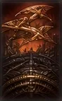
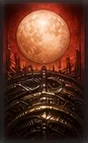
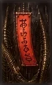

# Play it in three turns

One round, played out in front of you. One idea per line, the real cards at every step, and no
number you have to trust: the table in [step 6](#step-6-what-the-two-choices-cost) is computed by
the game's own scoring code while these docs are built.

!!! tip "If you remember nothing else"
    Match by **month**. Take what you match. When your score goes up, **bank it or push it**.

## Step 1 · The table you start on

<a class="table-map-btn" href="#table-map">zoom the table</a>'          '<a class="table-map-btn" href="#">close</a>

* **8** cards to you, **8** to him, **8** face-up in the middle, **24** face-down in the stock.
* The middle is the **field**. Every card you play, you play onto it.
* His hand stays face-down the whole round. The number under the stock is how many draws are left.
* Those panels on the left are where your captures go, sorted by type: **B**rights, **A**nimals,
  **R**ibbons, **P**lains.

## Step 2 · A turn is two stages, and you always do both

| Stage | Where the card comes from | Who picks it |
|---|---|---|
| **1. your hand** | your 8 cards | you, by dragging one onto the field |
| **2. the stock** | the top of the draw pile | nobody. It is turned over |

Both stages do the same thing with the same rule: **look at the field for the card's month.**

## Step 3 · Turn 1 — a capture that scores nothing

You play { .card-mini } and the field holds
{ .card-mini }. March against March, so **both come to
you**.

Then the stock turns over { .card-mini } and finds no July
on the field, so it stays face-up where it landed.

You now hold a Curtain and a Plain. That is **0 points**, so the game asks you nothing and the
turn passes to him. It is a normal turn: captures and points are not the same thing yet.

## Step 4 · Turn 2 — the stock can capture on its own

You play { .card-mini } onto
{ .card-mini } — both August, both yours.

The stock comes up { .card-mini }, and the field has
{ .card-mini }. Same month, so **they are captured
too**. You did not choose that, you could not stop it, and the drawn card never went into your
hand. It is still 0 points: two Brights and two Animals are not a combination yet.

## Step 5 · Turn 3 — the choice, which is the whole game

The field now holds two January cards:
{ .card-mini } and
{ .card-mini }. You play
{ .card-mini }.

Two matches means the game stops and asks which one you want. You may only take one.

* Take the **Crane** and it joins the Curtain and the Moon: three Brights, **Sanko**.
* Take the **Poetry ribbon** and the Crane stays face-up on the table. No set.

A third match would not ask: with three cards of your month on the field you take all three. With
one you take that one. Only **two** is a decision.

## Step 6 · What the two choices cost

The same turn, both ways, scored by the engine:

<!-- BEGIN GENERATED: tutorial-worked -->

| After | You have captured | What `score_captures()` makes of it | Bank it now | You called Koi-Koi once | He called it, you won |
|:--|:--|:--|--:|--:|--:|
| **turn 1** | { .card-mini } { .card-mini } | *nothing to score yet* = **0** | 0 | 0 | 0 |
| **turn 2** | { .card-mini } { .card-mini } { .card-mini } { .card-mini } { .card-mini } | *nothing to score yet* = **0** | 0 | 0 | 0 |
| **turn 3**, you take the Crane | { .card-mini } { .card-mini } { .card-mini } { .card-mini } { .card-mini } { .card-mini } { .card-mini } | Sanko 5 = **5** | 5 | 10 | 10 |
| **turn 3**, you take the ribbon | { .card-mini } { .card-mini } { .card-mini } { .card-mini } { .card-mini } { .card-mini } { .card-mini } | *nothing to score yet* = **0** | 0 | 0 | 0 |

*Base points and every award above come from this build's `score_captures()` and `calculate_award()` in `src/rules.c`, on the card ids in `src/cards.c`, under KK-ADD-10 -- the ruleset the game defaults to (`src/storage.c:35`). Nothing in this table is typed: the generator stops with an error if a capture in the example stops matching by month, if the deal turns into a misdeal, or if the third turn stops offering a real choice.*

<!-- END GENERATED: tutorial-worked -->

Five points is not much. It is the *third* line that matters: taking the Crane instead of the
ribbon is 5 points rather than 0, and every later turn is played from that pile.

## Step 7 · Then the prompt opens

Your score went up, so the game stops and offers two buttons.

* **Shobu** — stop. The points in the table above are yours and the round ends.
* **Koi-Koi** — keep playing, for more. Every call raises your own multiplier, and if he calls it
  too and then beats you, that call doubles what *he* takes.

So banking 5 is exactly 5. Call Koi-Koi once, finish the turn, bank, and the same five points are
10. That doubling is not a free upgrade: a Koi-Koi *he* called doubles what he takes if he wins the
round, which is why the table has a column for it. The arithmetic, in full, is on
[Multipliers & Awards](scoring/multipliers.md).

Two things about the prompt itself, because both surprise people. Under KK-ADD-10 it opens when a
combination is **new or has grown in points**, not on every capture — which is why nothing appeared
after turns 1 and 2 ([when the screen opens](rulesets/kk-add-10.md#when-the-koi-koi-screen-opens)).
And if your hand runs out, Koi-Koi is not offered at all: the round ends on its own.

## What to remember

1. Month, not picture. A January Plain matches a January Crane.
2. A card that can capture must capture. You may still play a card that cannot.
3. Two matches on the field is the only time you choose.
4. The stock plays itself, and it can capture.
5. Nothing is worth points until it forms a yaku. Zero points means no prompt.
6. Bank small, or push for the multiplier.

## Next

* The rules in full, with every card: [How to Play](how-to-play.md)
* Which rule set to pick, and what each one changes: [Rulesets](rulesets/index.md)
* What each combination is worth in every rule set: [Yaku & Scoring](scoring/yaku.md)
* How the awards are multiplied: [Multipliers & Awards](scoring/multipliers.md)
* When you are ready for the wall: [DEUS SUPREMUS](reference/deus-supremus.md)

*(The worked round above is a fixed set of card ids in `tools/wiki_tables.c`. The generator checks
the example against the engine before it writes this page: it refuses if a capture stops matching by
month, if the deal turns into a misdeal, or if turn 3 stops being a real choice.)*
